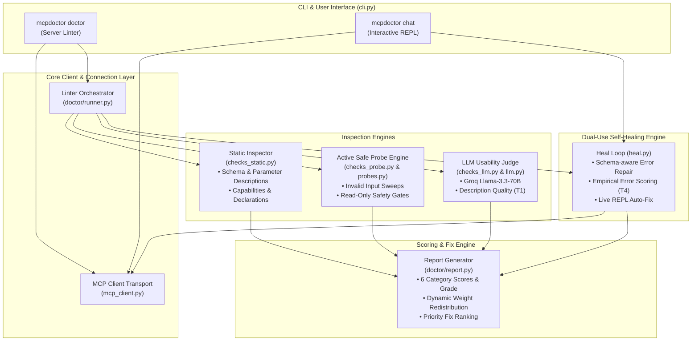

# mcpdoctor

> **An AI-usability linter for MCP servers — plus an interactive chatbot that heals its own broken tool calls.**

[](https://www.python.org/)
[](https://modelcontextprotocol.io/)
[](https://groq.com/)
[](https://docs.astral.sh/uv/)
[](docs/mcpdoctor-check-spec.md)
[](tests/)
[](LICENSE)

---

## Overview

AI agents frequently fail when interacting with Model Context Protocol (MCP) servers due to subtle usability oversights:
- Parameters like `date: string` with zero hints on whether to pass `2026-07-06` or `"tomorrow"`.
- Cryptic runtime errors like a bare `400` that give the model no guidance on how to fix its call.
- Dangerous operations (`delete_database`) lacking `destructiveHint` flags.
- Multiple servers exposing ambiguous, colliding tool names like `search`.

`mcpdoctor` interviews the model about its real-world frustrations, converting those pain points into **18 automated checks** across 6 weighted categories. It grades any MCP server on one fundamental question:

> **"Could an AI model use this server correctly on the first try, and self-heal on the second?"**

```
mcpdoctor — badserver (7 tools · 2 resources · 0 prompts)
Overall: F (25/100)

  Error Quality    ####------  43%   get_data: errors did not let the heal loop repair the call
  Tool Clarity     #---------   7%   process: static gate: only 1 words - says what but not when
  Safety           ----------   0%   delete_everything: destructive name but destructiveHint unset
  Resources        ####------  40%   data://config: declared application/json but content is not JSON
  Protocol Hygiene #####-----  50%   prompts capability declared but nothing registered
  Spec Extras      ----------   0%   no instructions field in initialize result

Top fixes (by points recovered):
  1. delete_everything - set destructiveHint: true on delete_everything (+15)
  2. badserver - register the primitive or drop the capability claim (+5)
  3. get_data - error should name the field, the expected format, and the received value (+4)

Probe safety:
  badserver/delete_everything: active probes skipped for safety
```

*Full example reports are available in [`docs/reports/`](docs/reports/) — including official filesystem servers, course servers, and deliberate test fixtures.*

---

## System Architecture

`mcpdoctor` combines static analysis, active schema-aware probing, and LLM-driven usability judging into a unified pipeline. At its core, the **Self-Healing Loop** ([`heal.py`](src/mcpdoctor/heal.py)) serves a dual purpose: powering live chatbot retries and acting as an empirical benchmark for error quality scoring during linting.



### Architectural Highlights

1. **Dual-Use Self-Healing Engine ([`heal.py`](src/mcpdoctor/heal.py))**:
   - **At Chat Runtime**: Intercepts failed tool calls, submits the error trace and schema back to the LLM, extracts corrected parameters, and transparently retries execution.
   - **At Lint Time (Check T4)**: Benchmarks error quality empirically. If the self-healing loop can repair a broken call from the server's error output in 1 retry, the error gets full points (2/2). Cryptic errors that fail repair score 0.
2. **Keyless Graceful Degradation**:
   - Without a `GROQ_API_KEY`, static and probe checks continue running in full. The two LLM-judged checks (T1 description quality, T4 repairability) fall back to safe defaults, explicitly flagging the final grade as a floor score.
3. **Safety-First Probe Sweeps**:
   - Destructive tools (matching patterns like `delete`, `drop`, `wipe`, or setting `destructiveHint`) are **never probed** without explicit `--unsafe` flags. Probes execute invalid schema inputs designed for instant rejection. Repaired probe calls are restricted strictly to verified read-only tools.

---

## Key Features

- **18 Comprehensive Usability Checks**: Evaluates Tool Clarity, Error Quality, Safety, Resources, Protocol Hygiene, and Spec Extras.
- **Empirical Scoring & Dynamic Weights**: Automatically redistributes category weights if primitives (like resources or prompts) are absent, ensuring fair grading.
- **Prioritized Fix Recommendations**: Ranks suggested fixes by the exact number of points recovered to guide developer fixes efficiently.
- **Interactive Self-Healing Chat**: Integrated REPL allowing developers to chat with their servers while automatically recovering from schema and parameter errors.
- **Rich Terminal UI & Flexible Exports**: Beautiful `rich` card layouts in terminal, with ASCII output (`--ascii`) and markdown export (`--md PATH`) support for CI pipelines.

---

## Installation

### Prerequisites
- Python `^3.12`
- [`uv`](https://docs.astral.sh/uv/) package manager

### Setup

```bash
# Clone the repository
git clone https://github.com/Siteshcodes/mcpdoctor.git
cd mcpdoctor

# Install dependencies into a virtual environment
uv sync
```

### Environment Configuration

Setting a `GROQ_API_KEY` enables the LLM Judge engine (`llama-3.3-70b-versatile`). Create a `.env` file in the root directory:

```env
GROQ_API_KEY=your_groq_api_key_here
```

> **Note**: `mcpdoctor` works out of the box without an API key! Keyless runs complete in seconds and return a floor grade.

---

## Usage

### 1. Lint an MCP Server

Run `mcpdoctor doctor` against a Python script (`.py`) or a shell command launching an MCP server:

```bash
# Lint a Python MCP server script
uv run mcpdoctor doctor fixtures/badserver.py

# Lint an NPX-hosted MCP server
uv run mcpdoctor doctor "npx -y @modelcontextprotocol/server-filesystem ./sandbox"

# Lint multiple servers simultaneously (reports namespaced as server:tool)
uv run mcpdoctor doctor serverA.py serverB.py
```

#### CLI Options

| Flag | Description |
| :--- | :--- |
| `--thorough` | Execute all 7 bad-input probe templates per tool (default is 3). |
| `--unsafe` | Probe tools flagged as destructive. **Caution**: Off by default. |
| `--ascii` | Output plain ASCII report card (useful for legacy terminals/CI logs). |
| `--md PATH` | Export full lint results as a markdown document to `PATH`. |
| `--fix` | Print ready-to-copy rewritten tool descriptions for T1 failures. |

---

### 2. Interactive Chat with Self-Healing

Launch an interactive chat session with your MCP server:

```bash
uv run mcpdoctor chat fixtures/otherserver.py
```

#### Example Healing Flow

```text
> Call fetch_metrics with the date set to the literal text "July 5th" (do not convert it)

[mcpdoctor] Calling fetch_metrics(date='July 5th')...
[mcpdoctor] Tool error: date must be YYYY-MM-DD, got 'July 5th'
[mcpdoctor] [self-healed] Retrying fetch_metrics(date='2026-07-05')...
[mcpdoctor] Result: {"metrics": {"status": "ok", "value": 42}}
```

Inside the chat REPL, you can also execute `/doctor` to run a fresh lint sweep against connected servers without interrupting your active chat session.

---

## Scoring Rubric & The 18 Checks

Servers are evaluated against 6 weighted categories (totaling 100 points):

| Category | Weight | Primary Focus | Key Checks |
| :--- | :---: | :--- | :--- |
| **Error Quality** | **30 pts** | Helpfulness and repairability of error outputs | **T4** (Heal loop repairability), **T7** (Garbage acceptance trap) |
| **Tool Clarity** | **25 pts** | Clear descriptions, triggers, parameter specs | **T1** (Description quality), **T2** (Parameter docs), **T3** (JSON schema valid), **T5** (Name collision), **T6** (Overlapping roles) |
| **Safety** | **15 pts** | Clear flagging of state-mutating tools | **S1** (Destructive naming without flag), **S2** (Annotations) |
| **Resources** | **15 pts** | Resource URI structure, mime types, validity | **R1** (URI design), **R2** (Content validity), **R3** (Mime match) |
| **Protocol Hygiene** | **10 pts** | Capability declaration compliance | **P1** (Declared vs registered primitives), **P2** (Prompt args), **P3** (Empty tools) |
| **Spec Extras** | **5 pts** | MCP spec enhancement fields | **X1** (Server instructions), **X2** (Icons/Metadata) |

*For complete scoring formulas, probe payload definitions, and prompt templates, refer to the [`docs/mcpdoctor-check-spec.md`](docs/mcpdoctor-check-spec.md).*

---

## Technical Discoveries

Building `mcpdoctor` revealed several crucial insights regarding MCP servers, frameworks, and LLM tool calling:

1. **Pydantic's Implicit `title` Fields**:
   Pydantic injects a `title` key into parameter JSON schemas by default. Early linter versions falsely marked parameters as "documented" until we explicitly filtered out default title fields.
2. **FastMCP Pre-Validation**:
   FastMCP validates primitive types *before* tool logic executes. The real failure vector in production isn't type mismatch, but **declared-but-unenforced constraints** (e.g., `date: string` formatted as `YYYY-MM-DD` that nothing validates until runtime).
3. **Probe Payload Safety Limits**:
   "Harmless" probe templates (e.g., `unknown_field`, `huge_string`) can accidentally execute successfully on loose servers. To prevent unwanted mutations, probe calls carry intentional schema violations or are skipped when no safe baseline exists.
4. **Multi-Layer Validation Boundaries**:
   Validation occurs across 3 distinct boundaries: Pydantic checks types, FastMCP checks protocol signatures, and Groq/LLM providers validate tool schemas server-side. Demonstrating runtime self-healing requires testing tool-body logic failures rather than simple type mismatches.

---

## Tech Stack & Testing

- **Language & Runtime**: Python `3.12`
- **Package Manager**: [`uv`](https://docs.astral.sh/uv/)
- **MCP Framework**: Official `mcp` Python SDK + `FastMCP`
- **LLM Integration**: `groq` (`llama-3.3-70b-versatile`)
- **CLI & Formatting**: `typer` + `rich`
- **Testing**: `pytest` + `pytest-asyncio`

### Running Tests

```bash
# Run unit & static integration tests (116 tests)
uv run pytest -q

# Run opt-in live tests against external servers
uv run pytest -m live
```

---

## Project Story & Devpost Summary

- **Inspiration**: Demos show AI agents interacting with polished MCP servers. Real-world servers often suffer from vague descriptions, missing parameter formats, and cryptic errors. `mcpdoctor` was created to quantify this usability gap and close it automatically.
- **What it does**: Grades MCP servers across 18 usability metrics, ranks top fixes by point impact, and provides a self-healing interactive chat runtime.
- **How it's built**: Built around three trust-bounded engines: a zero-execution Static Inspector, an Active Safe Probe Engine with strict safety boundaries, and an LLM Usability Judge.
- **Future Roadmap**:
  - **GitHub Action / CI Integration**: Fail pull requests when a server's grade drops below a threshold.
  - **Multi-Model Judges**: Add `--model` support for Claude and GPT-4o judges.
  - **Resource Summarization Middleware**: Middleware to summarize oversized MCP resources before context overflow occurs.

---

## License

Distributed under the [MIT License](LICENSE).
